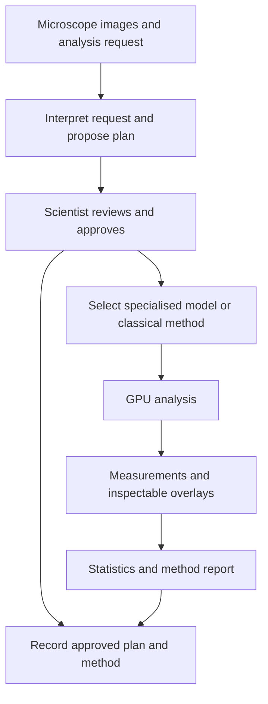

# VolkCell: from microscope images to reproducible measurements

[Open the product](https://www.volkcell.com) · [Back to my profile](https://github.com/GeorgeTMorris)

VolkCell is an AI image analysis product for biotech labs. Scientists describe the analysis they need, review a proposed plan and receive measurements they can inspect and repeat.

I am VolkCell's co-founder and CTO. I have written and shipped all of the product's code since February 2026, including the web application, GPU inference pipeline, model training and evaluation harness. My co-founder Ahmed Suliman owns the biology, assay design and validation against lab practice.

## A concrete workflow

A scientist uploads microscope images and asks, for example, "measure wound closure over 48 hours".

1. The system interprets the request and proposes an analysis plan.
2. The scientist reviews and approves that plan.
3. The pipeline selects the imaging method and runs the analysis on GPUs.
4. Results include measurements and overlays the scientist can inspect.
5. The product returns statistics across conditions and a report documenting the method.
6. The approved plan and method are recorded so the analysis can be repeated.

## Engineering decisions

**Separate planning from measurement.** A frontier language model interprets the request and plans the run. Specialised imaging models, open models and classical image analysis perform the measurements.

**Choose methods by evaluation.** Models are trained and benchmarked against expert labels. Each new base model is re-tested against the evaluation set before it changes a result. Classical methods are used where they are more reliable.

**Make outputs inspectable.** Scientists receive overlays alongside measurements and can correct outlines. With consent, a lab can train a model on its corrected images.

**Record the analysis method.** A useful scientific result needs more than a number. The approved plan and method are recorded so the run can be repeated.

## What I built

| Area | Implementation |
| --- | --- |
| Application and backend | Web application, Python and FastAPI services on Railway |
| Data and identity | Supabase Postgres and authentication |
| GPU inference | Modal, with PyTorch and ONNX imaging models |
| Model development | Cellpose/CPSAM-based segmentation and fine-tuned specialist models; training on Azure |
| Request planning | Claude interprets the scientist's request and plans the analysis |
| Supporting infrastructure | Cloudflare and Stripe billing |
| Quality | Evaluation harness and repeatable analysis records |

## A shipping example

For a CRO trial, I delivered RPE phenotyping, tube formation, choroid explant and retinal vessel analyses in under two weeks, working from the lab's images.

The broader product also supports cell counting and viability, confluency, wound healing, spheroids and organoids, and nanoparticles.

This is a public technical overview. The production source code, customer images and proprietary model assets are private.
